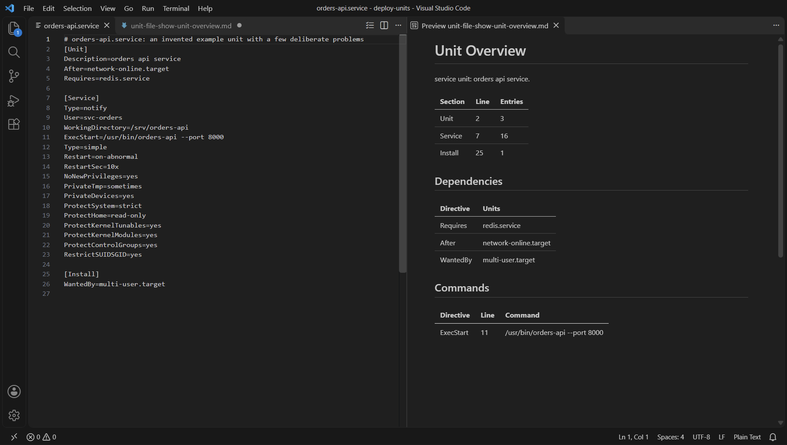
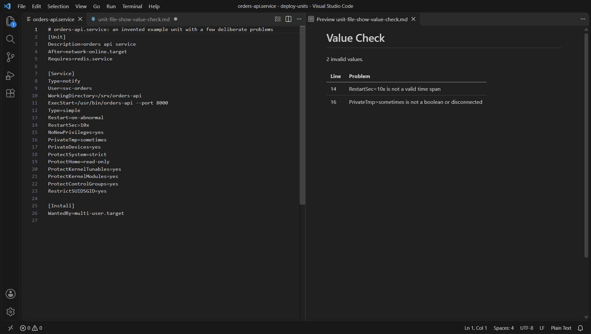
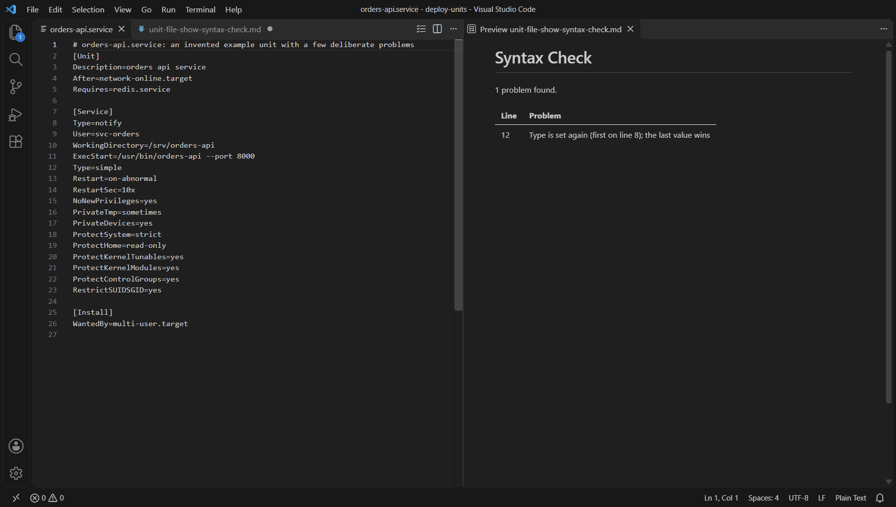
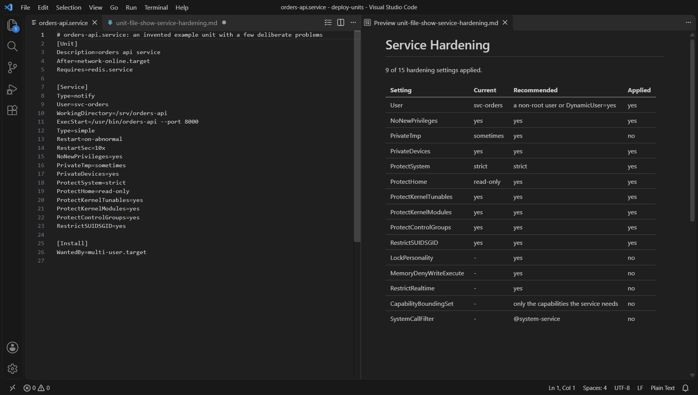
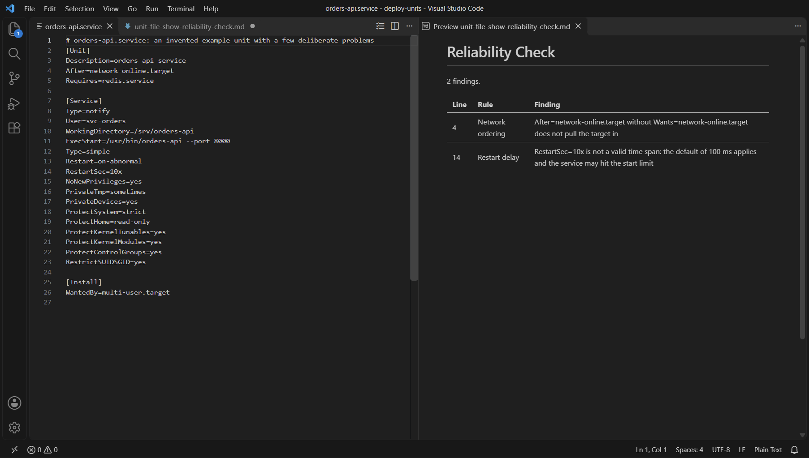

# Unit File Atlas

Unit File Atlas reads systemd unit files (.service, .timer, .socket, .path, .mount and more) and turns them into clear Markdown reports: what the unit runs and depends on, syntax problems, invalid values (booleans, time spans, Type= and Restart=), a 15-point hardening checklist and the reliability mistakes that bite in production, such as a missing Restart=, After=network-online.target without Wants=, or a timer that skips runs after a reboot.

Everything runs on your computer. There is no telemetry. The only network request the extension ever makes is the licence check for the optional Pro tier (see [Privacy](PRIVACY.md)).

## What it does

* **Show Unit Overview**: What the unit is, its sections, what it depends on and every command it runs.
* **Show Syntax Check**: Lines outside a section, lines that are not Key=Value, unknown sections and settings that are set twice.
* **Show Value Check**: Values systemd would reject: yes/no settings, time spans, Type= and Restart=.
* **Show Service Hardening** (Pro): A 15-point hardening checklist for services: non-root user, NoNewPrivileges, ProtectSystem, PrivateTmp and more.
* **Show Reliability Check** (Pro): Reliability mistakes: no restart policy, After= without Wants=, forking without PIDFile, no [Install], timers that skip runs.

## Free, trial and Pro

| Feature | Free | Pro |
| --- | :---: | :---: |
| Show Unit Overview | yes | yes |
| Show Syntax Check | yes | yes |
| Show Value Check | yes | yes |
| Show Service Hardening |  | yes |
| Show Reliability Check |  | yes |
| Open Sample File, walkthrough, Report A Problem | yes | yes |

The free reports need no key, no account and no network connection, and they will not be moved behind the licence key later. The first Pro command starts a **free 14-day trial** on this computer. After that, Pro is a one-time purchase, not a subscription: **Pro Personal USD 19** (one person, use at work allowed) or **Pro Business USD 39 per user** (one key per user of an organisation). A key works on up to 3 computers. The checkout page shows the final price and any taxes for your country. Licence keys are sold by Dodo Payments, the merchant of record. Details: [licence](docs/licence.md), [terms](TERMS.md).

## Commands

Open the Command Palette and type `Unit File Atlas`.

| Command | Tier |
| --- | :---: |
| Unit File Atlas: Show Unit Overview | Free |
| Unit File Atlas: Show Syntax Check | Free |
| Unit File Atlas: Show Value Check | Free |
| Unit File Atlas: Show Service Hardening | Pro |
| Unit File Atlas: Show Reliability Check | Pro |
| Unit File Atlas: Open Sample File | Free |
| Unit File Atlas: Open Sample Timer | Free |
| Unit File Atlas: Open Walkthrough | Free |
| Unit File Atlas: Show Documentation | Free |
| Unit File Atlas: Report A Problem | Free |
| Unit File Atlas: Buy Pro | Free |
| Unit File Atlas: Enter Licence Key | Free |
| Unit File Atlas: Show Licence Status | Free |
| Unit File Atlas: Remove Licence From This Machine | Free |

## Settings

| Setting | Default | Meaning |
| --- | --- | --- |
| `unitFileAtlas.maxFileSizeMB` | 50 | Largest file a report reads (0.1 to 50 MB; VS Code passes files only up to 50 MB to extensions). |
| `unitFileAtlas.openReportsAsPreview` | true | Open each report in the Markdown preview as well. |

## FAQ

**Does Unit File Atlas run systemd or systemctl?**
No. It reads the text of the open file only, on any operating system, and changes nothing. It is useful on Windows and macOS too, for example when you review a unit before it is deployed.

**Is the hardening checklist the same as systemd-analyze security?**
It is modelled on the same settings (NoNewPrivileges, ProtectSystem, PrivateTmp, a non-root user and so on), but it is a simpler checklist of 15 settings read from the file, not a score computed by systemd.

**Which time spans are accepted?**
The systemd forms: 5s, 1min 30s, 2 h, 55s500ms, 100ms, a bare number of seconds and infinity, with the units usec, msec, s, min, h, d, w, M and y.

**Why is After=network-online.target reported?**
After= only orders units. Without Wants=network-online.target (or Requires=) the target is never pulled in, so the service may start before the network is ready.

## For IT and procurement

* Publisher: SmallStepsStudio (Visual Studio Marketplace), smallstepsstudio (Open VSX).
* Network: one host, `live.dodopayments.com`, for the licence check only, and only after a key is entered. No telemetry. The trial uses no network.
* Files are read from the editor only; the extension writes no files and changes none.
* Source: <https://github.com/small-steps-studio/unit-file-atlas>.
* Licence agreement: [LICENSE.txt](LICENSE.txt). Terms: [TERMS.md](TERMS.md). Privacy: [PRIVACY.md](PRIVACY.md).

## Support

Run **Unit File Atlas: Report A Problem** or open an issue at <https://github.com/small-steps-studio/unit-file-atlas/issues>. Never post a licence key or confidential data in a public issue.

systemd is free software developed by its community; Unit File Atlas is an independent product and is not affiliated with or endorsed by the systemd project.
